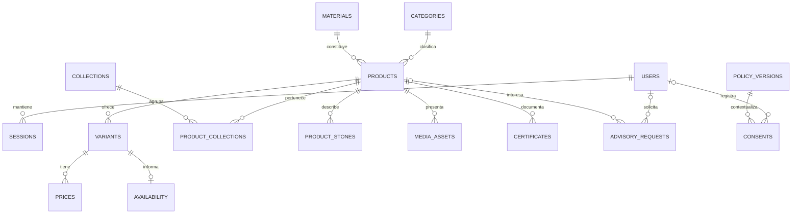

# Modelo de datos propuesto · Catálogo y asesoría

Diseño lógico, no migración ejecutada. No se modifica SQLite ni se implementa una API aquí. El agente elegirá tipos físicos y motor después de revisar el alcance aprobado.

## Actual frente a propuesto

La demo tiene `users`, `sessions` y `products`, esta última con ficha JSON. El seed vuelve a importar los diez ejemplos al arrancar. No tratar esa importación como un sistema editorial de producción. No migrar cuentas reales ni contraseñas a archivos de especificación; trabajar con datos sintéticos.

La propuesta normaliza categorías, colecciones, variantes, precios y medios para poder verificar y aprobar datos por separado. Se conserva `legacy_demo_id` para trazar un ejemplo antiguo, sin reutilizar su SKU como inventario comercial. PostgreSQL es una alternativa futura, no una obligación ni una migración autorizada.

## Relaciones de la fase A

`PRODUCT_STONES` conserva tipo, origen y cantidad por grupo de gema; por eso una pieza de zafiro y diamantes no se reduce a un ambiguo «origen mixto». Una foto no prueba origen ni tratamiento. Para plata sin piedra no crear un diamante nulo: no habrá filas en `product_stones`.

## Entidades y responsabilidad

| Entidad | Función | Dueño del dato | Exposición |
| --- | --- | --- | --- |
| users / sessions | Cuenta y sesión autenticada | Operación técnica | Solo cuenta propia; hash/token nunca público |
| categories | Tipo principal de joya | Catálogo | Pública si activa |
| materials | Metal, ley, quilataje y acabado declarados | Catálogo/proveedor | Público solo verificado |
| collections / product_collections | Curaduría transversal | Marca/catálogo | Pública si activa |
| products | Identidad, contenido y verificación | Catálogo | Fichas aprobadas |
| variants | SKU, talla, largo y opciones | Catálogo | Opciones y estado; sin costo interno |
| product_stones | Una o más agrupaciones de gemas | Responsable gemológico/proveedor | Características verificadas |
| media_assets | Vistas, alt, procedencia, permisos | Contenido | Según permiso/estado |
| certificates | Evidencia vinculada a producto o variante | Catálogo/proveedor | Documento solo si autorizado |
| prices | Precio y vigencia por variante | Propietaria/finanzas | Precio aprobado; costos no públicos |
| availability | Estado y plazo comercial | Operación | Estado aproximado confirmado, no stock preciso |
| advisory_requests | Consulta mínima y seguimiento | Atención | Privada, con acceso por rol |
| policy_versions / consents | Texto/versionado y finalidad | Responsable de privacidad/operación | Texto público; registro individual privado |
| audit_events | Quién cambió un dato y cuándo | Operación técnica | Interna; sin secretos en payload |

El diccionario de atributos está en `diccionario_datos.json` y su guía en `02_DICCIONARIO.md`. Estos archivos son la fuente para el agente, no una copia de una base ya construida.

## Reglas que debe preservar el agente

1. Identificador interno estable; SKU único por variante, slug único por producto, correo normalizado único por cuenta. El nombre mostrado conserva acentos.
2. Un producto tiene una categoría principal; muchas colecciones se resuelven con una tabla puente única por pareja. La navegación no duplica SKUs.
3. Precios en centavos enteros y moneda explícita. Períodos de vigencia sin solapamiento por variante/moneda. `valid_to` posterior a `valid_from` cuando exista. Precio final e impuestos mostrados según política fiscal aprobada.
4. Masa en gramos y dimensión en milímetros, con precisión definida. `k` corresponde al metal y `ct` a gema; no reutilizar una unidad para ambas. Mantener talla y sistema de talla juntos.
5. Disponibilidad comercial se confirma por variante. Bajo pedido puede carecer de existencias físicas; agotado no puede añadirse como pieza comprable. El plazo necesita fecha de verificación.
6. `is_demo` y `publication_status` son campos independientes. Producción solo admite publicados, aprobados y no demo. El agente debe impedir que cambiar una bandera publique fixtures.
7. Las imágenes guardan `source_kind=ai_generated|product_photo`, vista, permiso y alt. En demo el tríptico actual puede modelarse como un archivo con tres encuadres; antes de vender, validar fotografías de la pieza real. No registrar tres fotografías auténticas ficticias.
8. Un certificado conserva emisor, referencia, vínculo y verificación; no generar números. `not_applicable`, `pending` y `verified` tienen sentidos distintos.
9. Marketing es opcional y revocable, separado de atención y cuenta. No guardar PII en UTMs ni eventos publicitarios. Retención de contactos, backups y auditoría requiere plazos aprobados; no inventar una obligación de conservación.
10. El historial comercial no se borra al desactivar una categoría. Aplicar restricciones y archivo cuando haya referencias. Precios y políticas históricos se versionan; no reinterpretar una cotización antigua con el precio nuevo.

## Validación para publicar una ficha

Nombre, slug, categoría, descripción precisa, material/ley, medidas, variantes, estrategia de precio (`fixed` o `quote`), disponibilidad, tres medios autorizados, alt y responsable/fecha de verificación. Piedras y certificados se validan según corresponda, sin exigir certificado inexistente a toda pieza. Política y canal de asesoría deben tener una versión aprobada.

Si falta algo: mantener `draft` o `review`, indicar el faltante al editor y no ofrecer venta real. `producto_plantilla.json` contiene campos por completar; sus nulos son intencionales y **bloquean** publicación, no son datos comerciales.

## Migración y gobierno

Inventariar la base actual y hacer backup; construir correspondencia de IDs; importar categorías/colecciones sin duplicados; convertir los diez fixtures a entorno demo; conciliar número de productos, SKUs, precio y disponibilidad; probar lectura del catálogo; conservar rollback. Diseñar por separado cómo mover cuentas y sesiones sin exponerlas. Una importación repetida no debe sobrescribir contenido aprobado ni reactivar demos.

Accesos propuestos: público de lectura; atención solo consultas asignadas; editor de catálogo sin costos/secretos; aprobador comercial; administrador técnico. No confundir administrador de infraestructura con aprobador de materiales. Registrar actor, fecha y motivo en cambios relevantes.

## Extensiones de fase B, no incluidas en A

`inventory_locations`, `stock_movements`, `stock_reservations`, `carts`, `orders`, `order_items`, `payment_transactions`, `shipments`, `returns`, `refunds`, `addresses` y `invoices`. Necesitan pedido con precio/impuesto/política congelados, reservas atómicas por variante, idempotencia de pagos y devolución/conciliación. No almacenar datos de tarjeta. Los costes y estos trabajos permanecen en backlog futuro.

Para marketing avanzado: campañas, creativos y métricas agregadas pueden residir al inicio en archivos/tablero, sin convertir cada evento de navegación en una nueva base de PII. Integraciones externas dependen de necesidad y autorización explícita.
